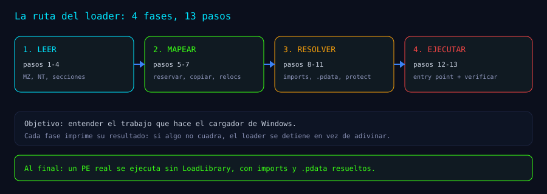

# mini-pe-loader

Un **loader de PE mínimo en C**, escrito para entender qué hace `LoadLibrary` por dentro:
leer las cabeceras, reservar y mapear las secciones, aplicar relocations, resolver imports,
registrar las tablas de excepciones y saltar al entry point.

Es **material didáctico**. No es un loader endurecido ni una herramienta de producción.

> **Artículo de apoyo:** [Mini-loader en 15 pasos](https://juanbarrero-art.github.io/blog/mini-loader-15-pasos-pe-sin-loadlibrary.html). Este repo implementa el núcleo (pasos 1–13); las extensiones 14–15 se explican en el artículo y no están incluidas aquí.



## Estructura

```text
src/miniload.c        loader + CLI
payloads/silent.c     PE de prueba que devuelve 7
payloads/seh.c        PE con __try/__except (prueba de .pdata)
payloads/hello.c      PE con un MessageBox
scripts/build.bat     compila loader + payloads en bin\
docs/testing.md       pruebas ejecutadas y resultados
docs/diagrams/        diagramas de apoyo
```

## Compilar

Requisitos: Windows 10/11 x64 y Visual Studio 2019+ Build Tools (`cl.exe`).

```bat
scripts\build.bat
```

Salida:

```text
bin\miniload.exe
bin\silent.exe
bin\seh.exe
bin\hello.exe
```

El script usa `cl.exe` si ya está en `PATH`; si no, localiza `vcvars64.bat` con `vswhere`.

## Ejecutar

```bat
:: PE que devuelve 7
bin\miniload.exe bin\silent.exe

:: PE con una excepcion capturada (necesita .pdata)
bin\miniload.exe bin\seh.exe

:: PE con un MessageBox
bin\miniload.exe bin\hello.exe
```

Ejemplo de salida (los números cambian entre builds):

```text
[parse] MZ ok; PE64 ok; secciones=6; ImageBase=0x140000000; SizeOfImage=0x1E000; entry RVA=0x1280
[map] base=00000233A6310000 (SizeOfImage=0x1E000)
[relocs] aplicadas: 775 (delta=0x23266310000)
[imports] resueltos: 70
[pdata] RtlAddFunctionTable: ok (339 entradas)
[pdata] lookup del entry: encontrado
[protect] secciones protegidas (RX/RW/RO)
[run] payload exit=7
```

## Qué hace cada paso

| Paso | Idea | Dónde |
|---|---|---|
| 1 | Leer el fichero y comprobar `MZ` | `ReadWholeFile`, `MapImage` |
| 2 | Localizar el NT header con `e_lfanew` | `MapImage` |
| 3 | Validar PE32+ (`0x20B`), `SizeOfImage` y entry RVA | `MapImage` |
| 4 | Recorrer secciones y entender RVA vs offset | `MapImage` |
| 5 | Reservar `SizeOfImage` en RW | `MapImage` |
| 6 | Copiar cabeceras y secciones (BSS a cero) | `MapImage` |
| 7 | Aplicar relocations `DIR64` | `ApplyBaseRelocations` |
| 8 | Resolver imports por nombre y ordinal | `ResolveImports` |
| 9 | Interceptar `ExitProcess` en la IAT | `ResolveImports`, `ExitStub` |
| 10 | Registrar `.pdata` para unwind/SEH | `RegisterExceptionTable` |
| 11 | Aplicar protecciones RX/RW/RO por sección | `SetSectionProtections` |
| 12 | Ejecutar el entry en un hilo y esperar | `ExecuteImage` |
| 13 | Verificar con `dumpbin` y el propio loader | `docs/testing.md` |

## Notas de diseño

- **W^X por secciones**: se reserva RW, se escribe y después se aplica RX/RW/RO según las
  características del PE. No se deja una región RWX.
- **Fail loud**: cabeceras inválidas, imports no resueltos o relocations desconocidas
  abortan con mensaje; nunca se sigue con una IAT a medias.
- **`ExitProcess` interceptado en la IAT**: el CRT de un EXE termina llamando a
  `ExitProcess`, que mataría al loader. El stub guarda el código y termina solo el hilo.
- **`.pdata`**: `RtlLookupFunctionEntry` no acepta `NULL` en el tercer argumento en esta
  build (provoca `0xC0000005`); se pasa una tabla de historial a cero.

## Límites

- No ejecuta callbacks **TLS** del PE.
- No resuelve **delay imports** ni soporta **bound imports** (`OriginalFirstThunk == 0`).
- No registra el payload para **CFG** ni gestiona **CET/IBT**.
- No es un loader endurecido: es material para aprender.

## Artículo

Material de apoyo del artículo
[Mini-loader en 15 pasos](https://juanbarrero-art.github.io/blog/mini-loader-15-pasos-pe-sin-loadlibrary.html).
